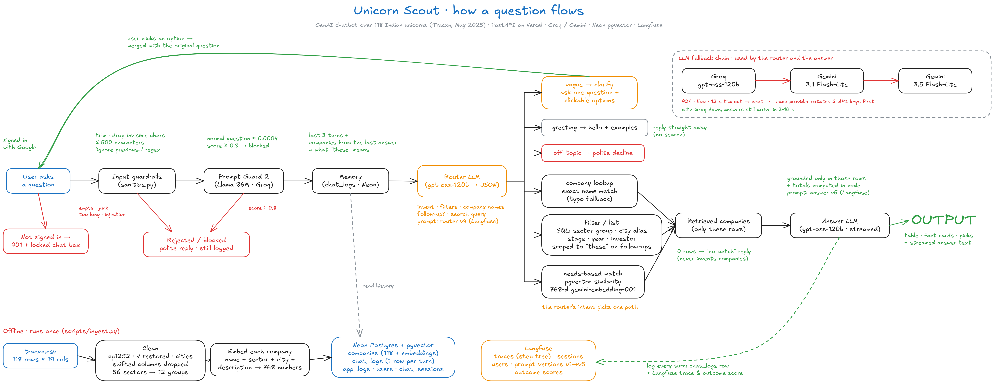

# Unicorn Scout: a chatbot for Indian unicorn startups

A Python GenAI chatbot that answers questions about the 118 Indian unicorns in the
[Tracxn / Kaggle dataset (May 2025)](https://www.kaggle.com/datasets/srisankargiri/list-of-118-unicorn-startups-in-indiamay-2025).
It keeps conversation context, asks a clarifying question when a request is vague, streams its work to a
web UI as it happens, and logs every turn with the prompt versions used.

**Stack (all free tiers):** FastAPI · Groq (`gpt-oss-120b`) with Gemini (`gemini-3.1-flash-lite`, then `gemini-3.5-flash-lite`) as fallback ·
Gemini embeddings (`gemini-embedding-001`, 768-d) · Neon Postgres + pgvector · Langfuse (tracing, prompt
management, scores) · Llama Prompt Guard 2 · Vercel.

## High-level design

[](https://excalidraw.com/#json=gTGHAMRl2Ihfv-6hr4Vra,7RfgGl_Imyp5UMSQDCqKjA)

[Open the diagram in Excalidraw](https://excalidraw.com/#json=gTGHAMRl2Ihfv-6hr4Vra,7RfgGl_Imyp5UMSQDCqKjA)

## Setup

Requires Python 3.11+ (developed on 3.12).

```bash
python -m venv .venv
.venv/Scripts/activate        # Windows; use `source .venv/bin/activate` on macOS/Linux
pip install -r requirements.txt pytest
```

Fill in `.env` (never committed):

| Variable | Where to get it |
|---|---|
| `DATABASE_URL` | Neon console → project → Connect → **pooled** connection string |
| `LANGFUSE_PUBLIC_KEY`, `LANGFUSE_SECRET_KEY`, `LANGFUSE_BASE_URL` | Langfuse → project → Settings → API Keys |
| `GROQ_API_KEYS` | console.groq.com/keys; comma-separate several keys to rotate on rate limits |
| `GEMINI_API_KEYS` | aistudio.google.com/apikey; comma-separated as above |
| `GOOGLE_CLIENT_ID`, `GOOGLE_CLIENT_SECRET` | Google Cloud → Google Auth Platform → Clients → Web application. Authorized redirect URI: `http://localhost:8000/auth/callback` (add `https://<your-domain>/auth/callback` when deployed). Required: chatting needs a signed-in Google account |
| `SESSION_SECRET` | Any long random string; signs the login cookie. Rotating it signs everyone out |

Load the data and prompts once:

```bash
python -m scripts.ingest                  # clean CSV -> embed -> upsert into Neon (idempotent; also migrates the schema)
python -m scripts.push_prompts "why"      # publish changed prompts to Langfuse as a new "production" version
```

## Run

```bash
uvicorn app.main:app --reload       # landing page at http://localhost:8000, chat at /chat
pytest -q                           # unit tests (no network needed)
```

**Deploy:** `vercel deploy`, then add the same env vars in Vercel → Project → Settings → Environment
Variables. Vercel detects the FastAPI `app` in `app/main.py`, serves `public/` from its CDN, and
`vercel.json` (`cleanUrls`) maps `/chat` to `chat.html`.

## Architecture

```
Browser (public/chat.html) ── POST /api/chat/stream (SSE) ──► FastAPI (app/main.py)
                                                                 │ worker thread
                                                                 ▼
chatbot.handle_turn(session, message, emit) ── one Langfuse trace per turn, grouped by session
   1. sanitize    normalize, length/malformed checks, injection regexes         (sanitize.py)
   2. guard       Llama Prompt Guard 2 classifier on Groq                       (llm.py)
   3. memory      last 3 turns + previous answer's company ids from chat_logs    (db.py)
   4. route       LLM → JSON: intent, filters, companies, follow-up flag,
                  search query, or clarifying question + options                (prompts.py "router")
   5. retrieve    SQL filters and/or pgvector similarity in one query            (db.py, embeddings.py)
   6. answer      streamed LLM answer grounded only in retrieved records         (prompts.py "answer")
   7. log         chat_logs row, app_logs, Langfuse spans and outcome score
   Each stage emits start/done events (with timings) that the UI renders live.
```

| Module | Responsibility |
|---|---|
| `app/data.py` | CSV loading and cleaning, sector groups, city aliases, money-field validation |
| `app/db.py` | Schema (with idempotent migrations) and every SQL query |
| `app/embeddings.py` | Gemini embedding calls (document and query task types) |
| `app/llm.py` | LLM calls with streaming, key rotation and provider fallback; prompt guard |
| `app/prompts.py` | Prompt definitions, fetched from Langfuse at runtime with a local fallback |
| `app/sanitize.py` | Input normalization and injection heuristics |
| `app/chatbot.py` | Orchestrates a turn and emits stage, company and token events |
| `app/observability.py` | JSON logs to stdout and to Postgres |
| `app/auth.py` | Google sign-in, the session cookie, the current user, and the sign-in requirement for chat |
| `app/main.py` | HTTP routes, ownership checks, the SSE relay and the static pages |
| `public/` | Landing page, chat app and shared design tokens (`base.css`) |

### Design decisions

- **Router + retrieval + grounded answer, not "stuff the CSV into the prompt".** Groq's free tier allows
  8K tokens/minute, and 118 full records is roughly 12K tokens. More importantly, routing makes behaviour
  explicit and observable: every turn has an intent, filters and an outcome you can count.
- **Hybrid retrieval.** "Fintech unicorns in Bangalore" is a structured question, so it is answered with exact
  SQL filters (complete and correct lists). "Who could help with last-mile delivery?" is semantic, so it uses
  pgvector similarity over company descriptions. One query can combine both.
- **A derived `sector_group` column.** The dataset has 56 fine-grained sectors and no "FinTech" value. A
  hand-written 56 → 12 mapping (`data.py`) is deterministic and reviewable, unlike asking an LLM to guess
  at query time.
- **Precomputed tallies.** For long lists, the answer prompt gets counts by city, sector, stage and founding
  year. The model kept miscounting ("Bengaluru hosts over half" for 13 of 28) until it was handed the arithmetic.
- **The UI renders the records, the LLM explains them.** Tables and fact cards show the data, so the answer
  prompt (v3+) writes observations instead of re-listing rows. That is shorter, cheaper, and harder to get wrong.
- **Conversation state lives in Postgres.** Serverless functions are stateless, so each turn rebuilds context
  from `chat_logs`: the last 3 exchanges for the LLM, plus the company ids from the latest answer within them,
  so that "which of *these*…" filters exactly that set rather than re-searching.
- **Clarify instead of guess.** The router returns `intent: "clarify"` with a question and clickable options when
  a recommendation has no stated need. It is told not to clarify if earlier turns already supplied the detail,
  and to merge the user's answer with the original request. The company list is in the router prompt, so an
  exact name like "Open" is never treated as ambiguous.
- **Prompt versioning.** Prompts are managed in Langfuse (label `production`) and linked to each generation.
  Every `chat_logs` row stores `prompt_versions` (e.g. `{"router": 4, "answer": 4}`), so a prompt change can be
  compared in SQL (`/api/metrics` → `by_prompt_version`) or in Langfuse. Four versions were shipped while testing,
  each fixing an observed failure (see the commit history). The local copy in `prompts.py` is used if Langfuse is
  unreachable and is recorded as `"fallback"`.
- **Streaming without losing trace context.** The SSE endpoint runs the turn in a worker thread and relays queued
  events, so the Langfuse/OpenTelemetry context stays on one thread instead of hopping between generator steps.
- **Defence in depth for prompt injection.** Regex heuristics (fast, deterministic), then a dedicated classifier,
  then prompts that treat the user message as data and allow answers only from retrieved records. SQL is fully
  parameterized; the UI escapes all HTML before rendering its small markdown subset.
- **Resilience.** The chain is Groq `gpt-oss-120b` → Gemini `gemini-3.1-flash-lite` → Gemini `gemini-3.5-flash-lite`.
  Each provider rotates through its API keys on any API error, including a per-call timeout (12 s for Gemini, whose
  free tier occasionally stalls for 20 s+), then falls back to the next. Measured with Groq fully down, turns completed
  in 3–10 s on the fallback. Fallbacks and rotations are logged and counted. Prompt Guard fails open; if every
  provider is down the user gets a friendly reply and an `error` row, never a stack trace.
- **Unknown URLs.** Page paths that don't exist get a branded 404 page; API and auth routes keep JSON errors (404, or
  422 for malformed ids and bodies). Only files directly inside `public/` are served, so `/.env` or `/app.py` are 404.
- **Embeddings via API, not a local model.** A local ONNX/PyTorch model would bloat the Vercel bundle and slow
  cold starts. Companies are embedded once at ingest, and each request embeds only the query.

### Observability

| Where | What |
|---|---|
| `chat_logs` (Postgres) | One row per turn: session id, timestamp, raw and sanitized query, response, intent, outcome (`answered`, `clarification`, `blocked`, `rejected`, `off_topic`, `greeting`, `error`), filters, retrieved company ids, clarifying options, prompt versions, provider/model, fallback flag, prompt/completion tokens, per-stage timings, context breakdown, latency, Langfuse trace id, error |
| `app_logs` (Postgres) + stdout JSON | Warnings (key rotations, rate limits, fallbacks, invalid router output), errors and per-turn summaries; stdout shows up in Vercel runtime logs |
| Langfuse | Trace per turn (guardrail → router generation → retriever → streamed answer generation), sessions, token usage, time to first token, linked prompt versions, and an `outcome` score |
| `/api/metrics`, the landing telemetry strip, the chat Context panel | Live totals and per-turn detail |

## Assumptions and limitations

- Answers reflect the dataset only (May 2025). No live data, so funding, valuations or status may be outdated.
- "Good fit for collaboration" is matched on company descriptions and sectors only; there is no data on
  partnership programmes, APIs or strategy.
- Free-tier rate limits (Groq: about 8K tokens/min per key) cap throughput at a few turns per minute per key; key
  rotation and the Gemini fallback absorb bursts. A turn on the fallback typically takes 3–10 s.
- The prompt-guard classifier fails open if it is unavailable; the regex layer and grounded prompts still apply.
- The context-window breakdown estimates each section's share from its character count, scaled to the provider's
  real prompt-token total.
- Chatting requires a Google account. The OAuth app is published ("In production") with only basic scopes
  (name, email, picture), so no Google verification is needed; adding a logo would trigger verification.
- No per-user rate limiting yet.

## With more time

- An evaluation set (questions → expected companies or outcomes) run as a Langfuse dataset experiment on every prompt change.
- Rate limiting per session/IP, and authentication for `/api/metrics`.
- A connection pool (`psycopg_pool`) for higher concurrency per function instance.
- User feedback (thumbs up/down) sent as Langfuse scores.
- A real "stop": today, stopping a streaming answer in the UI only closes the stream, while the server still
  finishes and logs the turn. With more time the server would cancel the LLM call too.
- Edit a sent message and re-run the turn from there.
- Send a new message while an answer is still streaming (queue it, or stop the current answer and start the new one).
